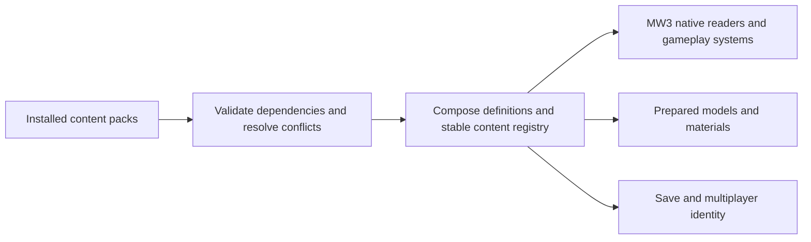

# Modular weapons, equipment and packs: MW3-RE investigation

Recorded 2026-11-07 for [issue #30](https://github.com/roswellien/CoreCritical-MW3-RE/issues/30).
This is a source investigation and proposed migration sequence. No runtime,
gameplay, installed pack or original media changed; no native execution boundary
advanced and no new live gameplay claim is made.

## Findings that change the Raven plan

MW3-RE already provides the gameplay/data foundation needed for this work.
Reuse it rather than porting the old translated-host catalogue bridge wholesale.
Keep Core Critical's pack installation and prepared visual formats, then add
content registration and composition against MW3-RE's native interfaces.

The earlier Raven investigation treated `equipment.zrd`'s missing Inner Sphere
ECM entry as a blocker. That does **not** establish availability in this target.
At the inspected revision, the authoritative runtime code already accepts
Inner Sphere ECM: `equip_kind("ecm")` is 8, `equip_has_tech(8, 2)` is true,
`equip_weight(8, 2)` returns 1.5 tons, and `equip_slots(8, 2)` returns 2.
No `equipment.zrd` reader was found in `src/`; weights, slots and availability
come from compiled code in [mech_names.cpp](../src/mech3/mech_names.cpp).

Guardian ECM can first be represented as an Inner Sphere equipment definition
using the **existing MW3 ECM effect**. Calling it Guardian does not establish
MW5 behavior, an area-of-effect field, allied protection or configurable range.
Those would require separately defined behavior and validation.

The owner selected the RVN-3L visual/animation prototype and deferred its playable
loadout. This investigation explains how to resume that boundary after the pack
architecture is ready; it does not silently choose a refit or change TAG.

## Source scope

The target is the user's `roswellien/CoreCritical-MW3-RE` fork, whose GitHub
parent is `telltaleatheist/mw3-re`. Inspected integration revision:
`7ab186357c6e99de4dd3ba4da56300cabf207015` (`origin/develop`, fetched for this
investigation). The default GitHub branch is `main`; the requested project
workflow still puts this topic PR into `develop`.

The separate `D:/Projects/MW34Recomp` checkout was read for the existing launcher
contracts. It has unrelated uncommitted work, including pack/coordinator files;
those files were not changed or committed. Descriptions of that working tree
are a migration inventory, not a claim that every observed change is released.

## What is stored where

| Content | Authoritative path in this target | What is data-driven now | Remaining compiled boundary |
| --- | --- | --- | --- |
| Projectile/beam definitions | `reader.zbd` entry `weapons.zrd`, parsed by [zwep_init.cpp](../src/gamez/zweapon/zwep_init.cpp) | Damage, range, rate, flight/homing flags, beam settings, soil impacts, models, animations and sounds | The parser and effect/flight algorithms are C++ |
| Game-specific weapon metadata | [weapon.cpp](../src/mech3/weapon.cpp), `WeaponType` | Heat, per-tech mass/slots, ammunition, salvo, NARC, recoil, recharge and airstrike reference | Mountable names, tech masks and ammo categories still use fixed catalogue entries |
| Mountable weapon catalogue | [mech_names.cpp](../src/mech3/mech_names.cpp) | Weapon lab weights resolve to the loaded definitions | 37 stock rows; an optional bug-fix row exposes the plain PPC as number 38; labels/tech/ammo masks remain tables |
| Equipment | `EquipmentItem` in [mech_config.h](../src/mech3/mech_config.h), `read_equipment` in [mech_reader.cpp](../src/mech3/mech_reader.cpp) | Loadouts choose item name, location and tech | Fifteen equipment kinds, mass/slots/tech rules, presentation and effect dispatch |
| Engines, armor and structure | [mech_names.cpp](../src/mech3/mech_names.cpp), [mech_config.cpp](../src/mech3/mech_config.cpp) | Loadouts choose ratings, XL, armor allocation and structure flags | Engine mass table, armor conversions and several accounting rules are C++ |
| Chassis/loadouts | `dfn_<name>.zrd`, [mech_reader.cpp](../src/mech3/mech_reader.cpp) | Movement, torso limits, loadout, skins and firepoints | Nineteen chassis identities, metadata and definition-cache slots; definitions do not alone add a selectable chassis |
| Visual replacements | [prepared_visuals.h](../src/platform/prepared_visuals.h), [prepared_models.cpp](../src/frontend/core_critical/prepared_models.cpp) | Prepared geometry, textures, normals and surface-material bindings | Bindings currently use source chassis/LOD identities, not a complete gameplay chassis registry |

The ZRD reader preserves typed integer, float, string and list values. An authoring
compiler must preserve those types and units, not assume arbitrary JSON numbers
or booleans are interchangeable. Existing stock parsers should remain the
compatibility authority for fields they already implement.

`weapons.zrd` can contain definitions that have no mountable row. Adding a
definition therefore does not automatically put a new weapon in the Mech Lab.
Likewise, editing a proposed `equipment.zrd` override would currently do nothing
to the compiled mass/slot switches. Make those connections explicit.

## Existing ECM and TAG behavior

ECM is already consumed across several systems:

- [mech_damage.cpp](../src/mech3/mech_damage.cpp), `Mech::mark_narc`:
  an installed ECM count clears the NARC timer.
- [sensors.cpp](../src/mech3/sensors.cpp), `make_record` and `sees`:
  equipment kind 8 sets the target ECM flag and blocks the BAP visibility bypass.
- [hud.cpp](../src/mech3/hud.cpp): target ECM affects the lead marker and lock
  presentation/timing; these are separate from projectile guidance.
- [weapon.cpp](../src/mech3/weapon.cpp), `Weapon::lock_on`:
  ECM suppresses an FCS-related tracking-state write. The existing source notes
  that zWeapon resets that state unread; do not advertise this as a demonstrated
  missile-homing improvement.
- [mech_parts.cpp](../src/mech3/mech_parts.cpp): equipment destruction updates
  the installed counts. A modded item must participate in this lifecycle.

These are target/installed-item checks, not evidence of a general ally-covering
jamming bubble. A proposed behavior such as `ecm_aura` would need a range/team
query, stacking and active-state rules, destruction handling, HUD/AI integration
and deterministic multiplayer behavior. Keep the stock effect as its own versioned
behavior rather than silently changing every stock ECM item.

TAG remains a separate issue. `WeaponType` reads `U_DESIGNATE_AIRSTRIKE` from
data. `configure_weapons` also recognizes equipment kind 13 and mounts weapon
index `0x20` at the first firepoint. A new designator cannot safely be made by
renaming TAG or changing its mass. Its desired designation effect needs an
explicit behavior contract and firepoint binding.

## Mod support worth preserving

[modding.md](modding.md), [mods.cpp](../src/mech3/mods.cpp) and
[assets-layer.md](assets-layer.md) describe and implement a useful base:

- `mod.txt` discovery, ordered `mod=` configuration and per-run `--mod` selection.
- Mount precedence: player write directory, enabled mods in order, imported patch,
  original installation. Player saves/configuration are not supplied by mods.
- Whole-file replacements and loose text ZRD overrides for reader entries.
- Additional worlds, Instant Action entries and text overrides.
- `--check-mod` with bounded resource readers.
- A gameplay-file hash checked by the multiplayer lobby; cosmetic files are excluded.

This is file replacement, not semantic merging of equipment/weapon definitions.
Two mods replacing `weapons.zrd` do not contribute independent weapon entries:
the first usable copy wins. Managed packs need definition-level composition.

Upstream's documented future work already includes making the name tables data,
new mechs/weapons and a launcher mod list. The proposed registry extends that
direction instead of creating an unrelated gameplay system.

The ZRD hook boundary needs particular care. [zreader.cpp](../src/gamez/zreader/zreader.cpp)
calls its load hook for binary archive reads, but returns successful mod-loose
and other loose text trees directly. [patch12.cpp](../src/mech3/patch12.cpp) owns
the existing single load/missing hooks. Replacing those callbacks would discard
the compatibility layer, and using only the current archive hook would miss
loose overrides. Establish an explicit composition stage covering the intended
load paths, preserving the existing patch's eligibility/order and tree ownership.

## What to carry forward from Core Critical packs

The existing launcher already has a useful outer contract:

- `.mw3pack` installation, enabled-pack ordering and rollback-oriented staging.
- `pack.json` identity/version, payload registry, file sizes and SHA-256 hashes.
- Required payload formats and runtime capability versions.
- Named additional chassis/skins, prepared meshes/textures and surface materials.
- Dependency/conflict metadata. Metadata declarations alone do not establish
  complete enforcement; confirm the resolver behavior for the new target.

Reference files in `MW34Recomp` are
`tools/mw3-remaster-launcher/Core/PackManifest.cs`, `PackManager.cs`,
`tools/remaster-launcher/content_capabilities.py`, `prepared_chassis_packs.py`,
and `docs/authoring-additional-mechs.md`.

The target fork already reads `BWMESH1` through `BWMESH6`, `BWTEX1`,
`BWNRM1` through `BWNRM3`, and validates surface-material identity/bindings.
It uses `CoreCriticalAssets` model/normal bindings and `PreparedMaterialBinding`.
This is useful visual infrastructure, not proof of an end-to-end pack importer
or an added gameplay chassis. A launcher adapter should translate a validated
resolved pack set into these typed interfaces.

Do not copy the old host's catalogue environment variable, numeric-address
adapters, resource aliases or inherited-metadata restrictions into the new runtime
as its public API. Reuse compatible payloads where validated; reimplement the
registration at MW3-RE's owned C++ boundaries.

## Proposed modular boundary

The following is a design proposal; these modules/capabilities do not exist yet.

Use one resolved registry with stock adapters, not separate launcher and game
catalogues that can disagree. Bootstrap stock entries at their existing IDs and
preserve the no-pack result. Each content definition should have a stable
namespaced ID, an owning pack, schema version and provenance. Session numeric
handles are implementation details with checked bounds.

Separate **item identity** from **behavior family**. Two ECM variants may have
different names, mass and slot counts but both use the existing ECM effect.
Do not append a new item number to `equipment[15]`: `configure_weapons` directly
indexes it, and damage, sensors and HUD consume particular family indices.
Resolve an item definition to an implemented family, keep per-item identity for
loadout/weight/display/save purposes, and derive the existing family counts from
intact installed instances. New behavior families need an explicit runtime change.

Make availability, mass, critical slots, display metadata, ammo category and
weapon family declarative where existing consumers can support them. Retain
native damage, heat, projectile, sensor and AI implementations behind registered,
versioned behavior IDs. New parameters become supported only when their consumers
exist; unknown required fields or behaviors must stop activation visibly.

The existing LRM optimization uses weapon indices `0x11..0x14`, and TAG uses
index `0x20`. Audit such consumers before permitting arbitrary new weapon rows;
moving names into a vector alone would not make the system modular.

Compose authored additions/patches by definition ID and field, using the player's
data as the base. Detect duplicate additions and overlapping edits; report both
pack/field owners and require an explicit ordering or patch relationship for an
intentional override. Preserve legacy file-overlay mods, with explicit conflicts
when they replace resources that managed definitions also compose. Cache composed
resources by source identity, ordered pack identities, schema/compiler versions
and payload hashes; never write them into the original installation.

Suggested content capabilities are `equipment-definitions`, `weapon-definitions`,
`chassis-definitions` and separately versioned effect capabilities. These are
proposed names, not current compatibility flags. Extend the real capability
allowlists and runtime advertisement only with the corresponding implementation.
Keep ordinary packs data-only; arbitrary DLL loading or a new scripting runtime
is not necessary to expose the existing item parameters.

## Saves, multiplayer and visible identity

[mech_config.cpp](../src/mech3/mech_config.cpp) saves numeric item IDs and tech;
its network packing masks item IDs to 16 bits and packs the chassis in 16 bits.
Stock configuration filenames derive from `mech_name`. The current chassis
cache is `g_dfns[19]` in `mech_reader.cpp`. These boundaries all need deliberate
adapters before additional content can be durable.

Keep old stock saves readable. A mod-aware save must preserve stable item/chassis
IDs, the required pack versions and any behavior/schema requirements needed to
resolve them. Missing content must produce an actionable message, not substitution
with whatever currently occupies an old numeric slot. Test reordered packs,
removed content, upgrades, export/import, campaign inventory and salvage.

For multiplayer, negotiate a deterministic ID map and fingerprint the **resolved
gameplay definitions and behavior versions**. Retain cosmetic-only compatibility.
The current `mods_gameplay_hash` is a file-based FNV-1a comparison, not publisher
authentication or semantic registry negotiation. Its extension-based exclusions
(including text files) must not accidentally omit a future equipment catalogue.
New packed identities need a versioned protocol or a checked compatible mapping;
never truncate a larger registry into the existing bit fields.

Display metadata also needs to follow item identity. Renaming the global ECM
message would rename other tech variants as well. Preserve localization fallback,
but let individual definitions supply their own label without requiring a new
message DLL or a per-item code change.

## Recommended implementation order

| Slice | Concrete deliverable | Completion evidence |
| --- | --- | --- |
| 1. Equipment registry with stock adapter | Expose existing equipment definitions and explicit behavior-family mapping; pack schema and runtime capability | No-pack stock equivalence; an authored variant changes mass/slots/label through actual Mech Lab consumers; missing/unknown behavior rejected; per-item damage removes its family contribution |
| 2. Pack composition and identity | Resolve Core Critical pack dependencies, field patches and resource ownership into MW3-RE | Two independent additions coexist; conflicts name both owners; old file overlays remain understood; stable save IDs survive pack reordering; gameplay mismatch rejected |
| 3. Weapon catalogue | Register mountable weapon metadata and reuse native weapon definition readers | A new weapon using an existing behavior appears, fires, consumes ammo/heat, survives save/load and behaves consistently in AI/network play; stock weapon-index special cases accounted for |
| 4. Additional chassis | Replace the nineteen-entry public restriction with owned registration and validated visual/controller bindings | A separately selectable Raven with original stock mechs intact; damage/muzzles/LODs, save/load, removal and lifecycle validated |
| 5. Optional new ECM/designator behaviors | Add only the chosen new behavior and supported parameters | Explicit baseline comparisons for detection, range/team rules, locks, NARC, HUD, AI, destruction and multiplayer; stock ECM/TAG preserved |

The first proof should use a **new definition backed by the existing ECM family**,
with a deliberately distinguishable test mass/slot/label so the test can detect
fallback to compiled constants. A Guardian definition can then select the intended
1.5-ton/two-slot Inner Sphere values and the stock MW3 ECM effect. A raw alternate
loadout containing `ecm` can test the existing runtime first, but it does not by
itself prove a new namespaced item registry or completed Raven pack support.

## Validation scope of this investigation

The findings above were checked against source at the pinned revision and the
existing test/documentation inventory. Relevant existing checks include
`tests/test_mods.cpp`, `tests/test_mech_reader.cpp`, `tests/test_mech.cpp`,
`tests/test_prepared_visuals.cpp`, and the differential weapon, sensor, damage
and configuration tests. These were inspected, not rerun as a native acceptance
suite for this documentation change. Future implementation should extend those
checks for the concrete criteria above rather than add a parallel report system.

Only documentation is submitted. Original/derived media and generated game code
are excluded. No Guardian behavior extension, item registry, Raven gameplay pack,
native game run or release is claimed by this PR.
